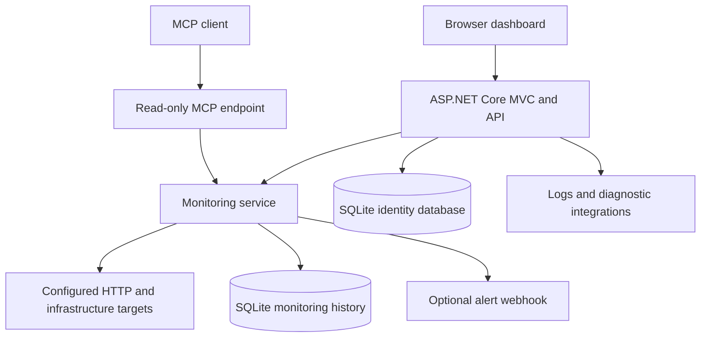

# SimpleStackWatch

A lightweight, self-hosted monitoring dashboard for applications and infrastructure. SimpleStackWatch brings HTTP health checks, Linux host metrics, database health, .NET diagnostics, logs and AWS EC2 information into one place, with an optional read-only Model Context Protocol (MCP) endpoint.

It is intended for developers and operators who want to observe a development, test or deployment environment without setting up a large monitoring platform. Targets are supplied by the operator; the application does not depend on any particular business application or cloud architecture.

## Contents

- [Features](#features)
- [How it works](#how-it-works)
- [Prerequisites](#prerequisites)
- [Quick start](#quick-start)
- [Configuration](#configuration)
- [Monitoring targets](#monitoring-targets)
- [Health history and alerts](#health-history-and-alerts)
- [User management](#user-management)
- [MCP integration](#mcp-integration)
- [Linux deployment](#linux-deployment)
- [Security and privacy](#security-and-privacy)
- [Development and testing](#development-and-testing)
- [Troubleshooting](#troubleshooting)
- [Contributing](#contributing)
- [License](#license)

## Features

| Dashboard section | What it provides |
| --- | --- |
| Overview | Unified health summary, search, environment filtering and recent check history. |
| Endpoints | Dedicated HTTP/HTTPS monitoring page with status and environment filters, name search, sortable columns and check history. Includes S3 endpoint reachability checks. |
| Logs | File log viewers, including application and Nginx logs, and optional PostgreSQL-backed Serilog logs. |
| .NET processes | Accessible local .NET processes and runtime counters; optional dotnet-monitor integration. |
| PostgreSQL | Multiple configured databases, connection health and session information. |
| Redis | Connection health and server statistics. |
| EC2 | Configured EC2 instance information and CloudWatch metrics. |

The Overview also includes CPU, memory, filesystem usage and configured systemd service checks on the local Linux host. Health history persists in SQLite; optional webhooks report status transitions. The interface uses grayscale styling, monospace typography and responsive navigation with light and dark themes. Browser access requires an account and time-based multi-factor authentication (MFA).

**Scope:** This is a single-instance monitor. It is not an automatic service-discovery platform, distributed tracing system, remote Linux agent or Kubernetes workload monitor. It does not send test messages, manage cloud resources or inspect S3 bucket contents. External integrations require network access and appropriate permissions. A healthy HTTP check means the configured response matched the check, not that every downstream business operation works.

## How it works



The hosted monitoring service polls configured targets in the background with bounded concurrency. The dashboard and MCP read the same stored monitoring results rather than independently polling each target. Detailed diagnostic pages have their own existing integration services. Authentication data and monitoring history are stored separately. Configuration is read during startup; restart the application after changing target definitions.

### Technology stack

- .NET 11, ASP.NET Core MVC, Razor views and built-in dependency injection.
- ASP.NET Core Identity, Entity Framework Core and SQLite for account storage; SQLite for health history.
- Bootstrap, JavaScript ES modules and CSS for the browser interface. No frontend bundler is required.
- Serilog, ASP.NET Core health checks, PostgreSQL and Redis clients, AWS SDK for EC2 and CloudWatch, and the official MCP C# SDK.
- xUnit and ASP.NET Core integration tests; Node.js built-in test runner for frontend tests.

## Prerequisites

| Requirement | When needed |
| --- | --- |
| .NET 11 SDK | Building, development and source-based CLI. |
| ASP.NET Core 11 runtime | Running a framework-dependent published application. |
| Linux and Bash | Provided shell scripts and local Linux monitoring. |
| Node.js and npm | Frontend tests; use a supported Node.js release with `node --test`. |
| `dotnet-counters` | Local .NET runtime counter collection only. |
| systemd and `/proc` | Local systemd and Linux resource checks only. |
| Nginx, TLS certificate, OpenSSL | Optional Linux reverse-proxy deployment and token generation. |

Check the tools on your machine:

```bash
dotnet --list-sdks
dotnet --list-runtimes
node --version
npm --version
```

Install the .NET diagnostics tool only if you plan to use process counters:

```bash
dotnet tool install --global dotnet-counters --version 10.0.731102
```

The diagnostic tool version is independent of the application target framework. Make its executable available to the account running the dashboard (or configure its absolute path).

## Quick start

Run commands from the root of your local repository checkout. Create the private launch profile first: `SimpleStackWatch.Dashboard/Properties/launchSettings.json`. The file is ignored by Git and is not supplied by a fresh public checkout. Create the `Properties` directory if needed.

```json
{
  "profiles": {
    "SimpleStackWatch (Local HTTP)": {
      "commandName": "Project",
      "launchBrowser": false,
      "applicationUrl": "http://localhost:5080",
      "environmentVariables": {
        "ASPNETCORE_ENVIRONMENT": "Development",
        "DOTNET_ENVIRONMENT": "Development",
        "Dashboard__Logs__EnableFileViewer": "false",
        "Dashboard__Monitoring__Enabled": "true",
        "Dashboard__Monitoring__Linux__Enabled": "true",
        "Dashboard__Monitoring__Linux__Environment": "Local",
        "Dashboard__Monitoring__Endpoints__0__Name": "Example website",
        "Dashboard__Monitoring__Endpoints__0__Url": "https://example.org/",
        "Dashboard__Monitoring__Endpoints__0__Environment": "Local"
      }
    }
  }
}
```

This example makes a real outbound HTTP request to a public example domain. Replace or remove that target if you do not want external checks. On a non-Linux machine, turn off Linux monitoring. All launch profile environment values must be JSON strings.

```bash
chmod 600 SimpleStackWatch.Dashboard/Properties/launchSettings.json
chmod +x run-debug.sh run-tests.sh run-cli.sh
dotnet restore SimpleStackWatch.slnx
./run-cli.sh add demo-user
./run-debug.sh
```

Choose a unique password of at least 12 characters and enroll a TOTP authenticator when prompted. Save recovery codes privately. Open <http://localhost:5080> and sign in. Select **Overview** or **Endpoints** to see the first checks. The default poll interval is 30 seconds.

`run-debug.sh` cleans, restores and non-incrementally builds the solution on every launch, then starts `dotnet watch` using the exact profile name `SimpleStackWatch (Local HTTP)`. It stops on build failure. Subsequent file changes use normal watch behavior. Alternatively, run without the full-rebuild wrapper:

```bash
dotnet run --project SimpleStackWatch.Dashboard/SimpleStackWatch.Dashboard.csproj \
  --launch-profile "SimpleStackWatch (Local HTTP)"
```

The CLI does **not** load launch profiles. The sample uses the default data directory for both CLI and web app; if you customize it, pass the same data directory to the CLI as an environment variable.

## Configuration

### Where to put settings

| Source | Purpose |
| --- | --- |
| `SimpleStackWatch.Dashboard/appsettings.json` | Generic application defaults. |
| `SimpleStackWatch.Dashboard/appsettings.Uat.json` | Generic monitoring switches for environment `Uat`. |
| `Properties/launchSettings.json` inside the dashboard project | Private local development settings, injected as process environment variables when the profile is selected. |
| `/etc/monitor-dashboard.env` | Private deployment settings loaded by systemd. |
| [`.env.example`](.env.example) | Tracked reference with placeholder values only. |
| `SimpleStackWatchDashboard.Test/testconfig.json` | Optional, untracked automated test settings. |

Normal tuning settings can come from JSON, then environment variables, then command-line overrides. The application separately rebuilds **private settings from process environment variables only**. This includes connection strings, credentials, monitoring names, URLs, labels, instance IDs, data/log paths and diagnostic endpoints. Setting these in `appsettings.json`, an environment-specific JSON file or on the command line is insufficient.

The .NET environment-variable separator is `__` (two underscores). For example, `Dashboard:Monitoring:PollSeconds` becomes `Dashboard__Monitoring__PollSeconds`. Use sequential zero-based indexes for collections, especially PostgreSQL databases; keep each name and its connection string at the same index. Do not add real infrastructure values to tracked examples.

The debug script also optionally sources a local `.env.local` in Bash format when present. It is not required when all settings are in the launch profile. Only source a file you control; shell sourcing executes its contents. Do not source a systemd environment file as Bash. Avoid conflicting values between configuration sources.

### General settings

The following keys are written in environment-variable form. Defaults and bounds are from the monitoring options and runtime implementation.

| Key | Default | Meaning |
| --- | --- | --- |
| `Dashboard__RefreshSeconds` | `10` | Browser refresh interval, 5–300 seconds. |
| `Dashboard__Monitoring__Enabled` | `true` | Enable background monitoring targets. |
| `Dashboard__Monitoring__PollSeconds` | `30` | Poll interval, clamped to 5–300 seconds. |
| `Dashboard__Monitoring__FailureThreshold` | `3` | Consecutive failures before Down (1–20). |
| `Dashboard__Monitoring__RecoveryThreshold` | `2` | Consecutive successes to recover (1–20). |
| `Dashboard__Monitoring__RetentionDays` | `14` | History retention, clamped to 1–365 days. |
| `Dashboard__Monitoring__MaxConcurrentChecks` | `6` | Concurrent checks, clamped to 1–16. |
| `Dashboard__Monitoring__MaxHttpEndpoints` | `100` | Positive configurable HTTP target limit. |
| `Dashboard__DataDirectory` | `data` | Private account, key and history storage path. |
| `LogSettings__FilePath` | `logs/app-.log` | Private application log path. |
| `Dashboard__LoginRequestsPerMinute` | `20` | Login request rate-limit setting. |
| `AllowedHosts` | `localhost;127.0.0.1` | Accepted host names; set the real hostname privately for deployment. |

Relative paths resolve from the application's content root. Use absolute paths for deployment and when the CLI and web application might have different working directories.

## Monitoring targets

All examples below use placeholders or public example addresses. Merge the relevant entries into the existing launch profile's `environmentVariables` object, or translate each pair into `KEY=value` for the server environment file. Do not replace your whole configuration with an individual snippet.

### HTTP application endpoints

Each application needs only a name and a URL. Add as many numbered pairs as needed, up to the configured limit:

```json
{
  "Dashboard__Monitoring__Enabled": "true",
  "Dashboard__Monitoring__MaxHttpEndpoints": "100",
  "Dashboard__Monitoring__Endpoints__0__Name": "Application A",
  "Dashboard__Monitoring__Endpoints__0__Url": "https://api.example.org/healthz",
  "Dashboard__Monitoring__Endpoints__1__Name": "Application B",
  "Dashboard__Monitoring__Endpoints__1__Url": "https://api.example.net/healthz"
}
```

The example hostnames illustrate the format; replace them with endpoints you operate or are authorized to monitor. Configure the next free index for each additional target. The same checks appear in Overview and Endpoints and are available to MCP when enabled.

For each `Dashboard__Monitoring__Endpoints__N__` entry, the supported fields are:

| Field | Default | Description |
| --- | --- | --- |
| `Name` | Required | Human-readable application name. |
| `Url` | Required | Absolute HTTP/HTTPS URL without embedded credentials or a fragment. |
| `Id` | Generated | Stable optional identifier using letters, digits, `.`, `_` or `-`; starts with a letter or digit. |
| `Environment` | `Default` | Environment label, e.g. `Local` or `Test`. |
| `Group` | `Applications` | Logical grouping. |
| `ExpectedStatusCode` | `200` | Exact expected HTTP response code (100–599). |
| `TimeoutSeconds` | `10` | Per-check timeout (1–60 seconds). |
| `ReachabilityOnly` | `false` | Check whether the endpoint responded rather than requiring one exact code. |
| `HeaderName` | Empty | Optional HTTP request header. |
| `HeaderValue` | Empty | Private header value; environment only. |

IDs are generated deterministically from name, environment and canonical URL, not the list index. Reordering HTTP targets does not change their generated IDs. Changing those identity fields does change the ID; set a stable explicit ID if history continuity matters. IDs must be unique (case-insensitive). Keep existing IDs for existing targets; never reuse one for a different application. HTTP redirects are not followed and response bodies are not used to decide health. Use an application-provided health endpoint that checks the dependencies you care about. Do not place credentials in URLs.

**Endpoints page:** open `/dashboard/endpoints`. It displays HTTP targets only, including reachability-mode targets. Sort by application name, status, latency or last checked; the default puts unhealthy targets first. Filter by environment/status, search by application name, and select a target to inspect its stored history. The unified Overview remains unchanged.

### AWS S3 endpoint availability

No AWS credentials or S3 client library are needed for this check. Use your region's public S3 HTTPS endpoint and a free HTTP target index:

```json
{
  "Dashboard__Monitoring__Endpoints__2__Name": "Object storage endpoint",
  "Dashboard__Monitoring__Endpoints__2__Url": "https://s3.us-east-1.amazonaws.com",
  "Dashboard__Monitoring__Endpoints__2__Group": "Infrastructure",
  "Dashboard__Monitoring__Endpoints__2__ReachabilityOnly": "true"
}
```

In reachability mode, an HTTP response below 500 (including 403 and 404) counts as a successful reachability reading. HTTP 5xx, timeouts, DNS and connection failures count as failed readings. This confirms only that the configured endpoint responds; it does not validate bucket permissions, object access or application storage operations.

### Linux host and systemd

```json
{
  "Dashboard__Monitoring__Linux__Enabled": "true",
  "Dashboard__Monitoring__Linux__Environment": "Local",
  "Dashboard__Monitoring__Linux__DiskPaths__0": "/",
  "Dashboard__Monitoring__Linux__Services__0": "example.service"
}
```

Replace the illustrative systemd unit with one that actually exists on the monitoring host, or omit it. Add additional indexed disk paths and units as needed. CPU and memory are measured locally through `/proc`; disk paths measure their backing filesystem. Units are checked via `systemctl is-active`. The usage warning and critical thresholds default to 80% and 95% (`WarningPercent` and `CriticalPercent` under the Linux settings); warning must be below critical. This integration does not collect metrics from remote Linux hosts.

### PostgreSQL

Provide one name and connection string per database. The display name need not equal the physical database name.

```json
{
  "Dashboard__Postgres__Environment": "Local",
  "Dashboard__Postgres__ShowQueryText": "false",
  "Dashboard__Postgres__Databases__0__Name": "Application database",
  "Dashboard__Postgres__Databases__0__ConnectionString": "Host=DB_HOST;Port=5432;Database=DB_NAME;Username=MONITOR_USER;Password=REPLACE_ME;Timeout=5;Command Timeout=5",
  "Dashboard__Postgres__Databases__1__Name": "Reporting database",
  "Dashboard__Postgres__Databases__1__ConnectionString": "Host=DB_HOST;Port=5432;Database=REPORT_DB;Username=MONITOR_USER;Password=REPLACE_ME;Timeout=5;Command Timeout=5"
}
```

Use real private values only in the untracked profile or deployment environment. Prefer a dedicated, least-privileged monitoring role with connection access and the permissions required for session visibility (for example, evaluate whether `pg_read_all_stats` is appropriate). Configure transport security for remote connections. Query text is off by default; it may contain sensitive data. `MaximumRows` defaults to 100 (clamped to 1–500).

Use sequential indexes without gaps and unique nonempty names. A database without a connection string is not included in background health targets. PostgreSQL target IDs use indexes (`postgres:0`, etc.), so keep the ordering stable to avoid mixing history across databases. The legacy single `Dashboard__Postgres__ConnectionString` environment setting is supported only when no indexed database list is present.

### Redis

```json
{
  "Dashboard__Redis__ConnectionString": "REDIS_HOST:6379,password=REPLACE_ME,allowAdmin=true",
  "Dashboard__Redis__Environment": "Local"
}
```

The existing client uses PING and INFO; `allowAdmin=true` permits the required administrative client operation. Grant only required server-side ACL permissions and configure TLS where needed. A missing connection string disables this target.

### AWS EC2 and CloudWatch

```json
{
  "Dashboard__Aws__Enabled": "true",
  "Dashboard__Aws__Region": "us-east-1",
  "Dashboard__Aws__InstanceIds__0": "i-REPLACE_ME",
  "Dashboard__Aws__Environment": "Test"
}
```

Supply real instance identifiers privately and use the AWS SDK credential chain, preferably an IAM role or short-lived credentials. Required actions include `ec2:DescribeInstances` and `cloudwatch:GetMetricStatistics`. Restrict permissions where supported. CloudWatch data can be delayed or missing and API calls may incur charges. The Overview shows an EC2 summary; use the EC2 page for per-instance metrics. This is distinct from S3 reachability and is disabled by default.

### Logs and .NET diagnostics

| Setting | Purpose |
| --- | --- |
| `Dashboard__Logs__EnableFileViewer` | Enable/disable file log viewer. |
| `Dashboard__Logs__Folder` | Directory of logs, not a glob. |
| `Dashboard__Logs__Folders__0__Id`, `__Name`, `__Folder` | Additional named log directory (repeat the full prefix for each field). |
| `Dashboard__Logs__Database__Enabled` | Enable PostgreSQL log integration. |
| `Dashboard__Logs__Database__ConnectionString`, `__Schema`, `__Table` | Private compatible Serilog database settings. |
| `Dashboard__Processes__CountersExecutable` | Diagnostic executable path or name. |
| `Dashboard__Processes__AllowedProcessIds__0` | Restrict process monitoring to listed PIDs; empty means all accessible processes. |
| `Dashboard__Processes__Monitor__Enabled` | Enable optional dotnet-monitor integration. |
| `Dashboard__Processes__Monitor__BaseUrl`, `__MetricsBaseUrl`, `__ApiKey` | Private diagnostic service settings. |

File viewers require readable files and writable `.serilog-viewer` index directories. The application's own log directory is included automatically when the file viewer is used. Supported formats include Serilog, CLEF/JSON and standard Nginx logs. Database logs require a compatible Serilog table. `dotnet-counters` must be available to the dashboard account with access to diagnostic sockets; do not grant broad root permissions as a shortcut. dotnet-monitor is a separate service and must be secured independently. Logs and diagnostic results can include sensitive application data.

## Health history and alerts

| Status | Meaning |
| --- | --- |
| Healthy | A successful check, subject to recovery rules. |
| Degraded | A failure below the failure threshold, a degraded reading or recovery in progress. |
| Down | The configured consecutive failure threshold has been reached. |
| Unknown | No usable measurement or the last measurement is stale. |

A reading is stale after the greater of 90 seconds or three configured poll intervals (using the effective clamped interval). Monitoring history is stored in `monitoring.db` under `Dashboard__DataDirectory`. The account database is `users.db`. The legacy authenticated health integration at `/integrations/health` has separate in-memory history that resets on restart. The internal `/healthz` is protected by a process-local health key, not an anonymous readiness endpoint.

Configure the optional `Dashboard__Monitoring__Alerts__WebhookUrl` in the private environment to receive JSON notifications when a known target transitions to Down or returns to Healthy from Down/Degraded. Thresholds reduce alert flapping; persisted state helps avoid duplicates across restarts. Delivery is best-effort, not a durable notification queue. The receiver must use HTTPS (or loopback HTTP for local testing). It should be trusted to receive monitoring metadata. No notifications are sent by default.

For large installations, tune poll interval, timeout and concurrency together. Slow checks can make readings stale. Monitor disk space and back up the data directory using a SQLite-consistent backup method or while the application is stopped.

## User management

Accounts are managed by a local CLI, not public registration. Run from the solution root:

```bash
./run-cli.sh                   # Interactive menu
./run-cli.sh --help            # Help (also help or -h)
./run-cli.sh add demo-user     # Interactive password and MFA enrollment
./run-cli.sh list
./run-cli.sh reset-password demo-user
./run-cli.sh reset-mfa demo-user
./run-cli.sh disable demo-user
./run-cli.sh enable demo-user
./run-cli.sh unlock demo-user
```

The password minimum is 12 characters. Choose a strong unique password and use a time-based authenticator. Enter the setup key exactly, complete enrollment with the current six-digit code, and save the single-use recovery codes offline. Do not pass passwords as CLI arguments or capture enrollment output in logs.

Password reset preserves MFA. MFA reset replaces the authenticator key and recovery codes. Resets invalidate existing sessions. Disabling blocks login; enabling requires MFA enrollment; unlocking clears lockout. The CLI defaults to Development and rejects conflicting `DOTNET_ENVIRONMENT` and `ASPNETCORE_ENVIRONMENT` values. It does not load launch profiles or the systemd environment file. Always use the same environment and data directory as the dashboard instance whose users you intend to manage.

The underlying command is `dotnet run --project SimpleStackWatch.Dashboard/SimpleStackWatch.Dashboard.csproj --no-launch-profile -- users list`. The wrapper runs it from the dashboard project directory to keep default relative paths consistent.

## MCP integration

The optional read-only MCP server uses stateless Streamable HTTP at `/api/mcp`. It is disabled by default and uses separate bearer-token authentication, not the dashboard login cookie.

| Tool | Arguments | Purpose |
| --- | --- | --- |
| `get_overview` | None | Current health summary and targets. |
| `list_targets` | None | Target IDs, names, environments, groups and kinds. |
| `get_target_status` | `targetId` | Latest status of one configured target. |
| `get_target_history` | `targetId`, `limit` | Recent history, newest first; limit clamped to 1–200. |

Enable it privately:

```dotenv
Dashboard__Mcp__Enabled=true
Dashboard__Mcp__BearerToken=REPLACE_WITH_A_FRESH_RANDOM_TOKEN
```

Generate a fresh token locally with `openssl rand -hex 32`. Store the result in the protected environment file; the application requires 32–512 non-whitespace characters when MCP is enabled. Never commit the token or put it into a URL. Configure the client with the Streamable HTTP URL `https://monitor.example.org/api/mcp` and an `Authorization: Bearer <token>` header. Use HTTPS for remote connections. The legacy SSE transport is not enabled. Disabled MCP returns 404; an invalid or missing token returns 401 when enabled. A valid token grants read access to configured monitoring metadata and history, not log viewers or control operations.

### Restrict MCP with Nginx

Inside your existing HTTPS server block, use a dedicated location and replace the documentation-only client IP with your approved source address:

```nginx
location = /api/mcp {
    allow 192.0.2.10;
    deny all;
    proxy_pass http://127.0.0.1:5080;
    proxy_http_version 1.1;
    proxy_set_header Host $host;
    proxy_set_header X-Forwarded-For $remote_addr;
    proxy_set_header X-Forwarded-Proto $scheme;
    proxy_buffering off;
    proxy_read_timeout 120s;
}
```

Apply equivalent restrictions to any alternate path or proxy that can reach the MCP route (including path variants handled by your proxy). Bind the application to loopback or an explicitly protected private listener so clients cannot bypass Nginx. Keep bearer authentication enabled; IP restrictions are an additional layer. Do not restrict the entire `/api/` prefix unless you also want to restrict the browser dashboard APIs. If another proxy sits in front of Nginx, configure trusted real-IP handling before relying on allowlists.

After deployment, test missing/invalid token rejection and initialize a supported MCP client; call `list_targets` and a status/history tool for a known target. A browser GET alone is not an MCP protocol test.

## Linux deployment

The following is a framework-dependent Linux deployment example for an administrator. Adapt paths and service names to your host. Run system-level commands only on a machine you administer. Install the ASP.NET Core 11 runtime and confirm `Microsoft.AspNetCore.App 11.0.x` appears in `dotnet --list-runtimes`.

### Publish and prepare storage

From the repository root on a build machine with the SDK:

```bash
dotnet restore SimpleStackWatch.slnx
dotnet build SimpleStackWatch.slnx -c Release --no-restore
dotnet test SimpleStackWatch.slnx -c Release --no-build
dotnet publish SimpleStackWatch.Dashboard/SimpleStackWatch.Dashboard.csproj \
  -c Release -o ./publish
```

Create a dedicated non-root service account named `monitor-dashboard` if it does not exist. Install the published files under `/opt/monitor-dashboard`; keep application binaries read-only to that account. Prepare writable private storage and log directories on the host:

```bash
sudo install -d -m 0700 -o monitor-dashboard -g monitor-dashboard /var/lib/monitor-dashboard
sudo install -d -m 0700 -o monitor-dashboard -g monitor-dashboard /var/log/monitor-dashboard
```

Create the environment file if it does not exist, then restrict it to administrators:

```bash
sudo touch /etc/monitor-dashboard.env
sudo chown root:root /etc/monitor-dashboard.env
sudo chmod 600 /etc/monitor-dashboard.env
sudoedit /etc/monitor-dashboard.env
```

Example contents (replace the documentation hostname):

```dotenv
DOTNET_ENVIRONMENT=Production
ASPNETCORE_ENVIRONMENT=Production
ASPNETCORE_URLS=http://127.0.0.1:5080
AllowedHosts=monitor.example.org;localhost;127.0.0.1
Dashboard__DataDirectory=/var/lib/monitor-dashboard
Dashboard__Logs__Folder=/var/log/monitor-dashboard
LogSettings__FilePath=/var/log/monitor-dashboard/app-.log
Dashboard__Monitoring__Enabled=true
Dashboard__Monitoring__Linux__Enabled=true
Dashboard__Mcp__Enabled=false
```

Add the chosen monitoring targets and credentials using the earlier examples. Quote values with spaces where required by systemd's `EnvironmentFile` syntax. Do not use shell substitutions or `export` in this file. The checked-in `.env.example` is a reference, not a ready-to-deploy configuration. Never store the populated environment file in the public checkout.

### Start the service

Review [the supplied systemd unit](SimpleStackWatch.Dashboard/scripts/monitor-dashboard.service) before installing it. **Important:** the supplied unit still references `MonitorDashboard.dll`, while the current project normally publishes `SimpleStackWatch.Dashboard.dll`. Verify the published filename and correct `ExecStart` in your installed unit before starting it. Also confirm the actual absolute path to `dotnet`, working directory, account and environment-file path. The supplied unit requires the environment file to exist.

After installing the corrected unit as `/etc/systemd/system/monitor-dashboard.service`, provision the first user from the published directory with matching private storage and environment settings. For the example deployment above (adjust if yours differs):

```bash
cd /opt/monitor-dashboard
sudo -u monitor-dashboard env \
  DOTNET_ENVIRONMENT=Production ASPNETCORE_ENVIRONMENT=Production \
  Dashboard__DataDirectory=/var/lib/monitor-dashboard \
  Dashboard__Logs__EnableFileViewer=false \
  LogSettings__FilePath=/var/log/monitor-dashboard/app-.log \
  dotnet SimpleStackWatch.Dashboard.dll users add operator
```

The CLI does not automatically inherit the service's environment. Pass other required non-secret settings privately as appropriate; do not place credentials on command lines. Then enable and start the installed unit:

```bash
sudo systemctl daemon-reload
sudo systemctl enable --now monitor-dashboard
sudo systemctl status monitor-dashboard --no-pager
sudo journalctl -u monitor-dashboard -n 50 --no-pager
```

Restart the service after private configuration changes. Review logs locally; redact sensitive information before sharing them.

### Reverse proxy

Use a valid HTTPS certificate and keep the upstream app bound to loopback. Within your existing HTTPS Nginx server block, a dashboard location can look like this:

```nginx
location / {
    proxy_pass http://127.0.0.1:5080;
    proxy_http_version 1.1;
    proxy_set_header Host $host;
    proxy_set_header X-Forwarded-Proto $scheme;
    proxy_set_header X-Forwarded-For $proxy_add_x_forwarded_for;
}
```

Add the separate MCP location from the previous section if enabled. The application trusts forwarded headers from loopback proxies by default; a non-loopback proxy needs its own trusted-proxy configuration. Do not trust arbitrary forwarded IP headers. Validate the installed configuration with `sudo nginx -t` before reloading Nginx. Verify sign-in, MFA, dashboard APIs and monitoring from the intended client network. Do not expose the application port publicly alongside Nginx.

## Security and privacy

The repository is public; its operational data is not. Keep the code reusable and all deployment-specific values out of tracked files.

- Keep local launch profiles, `testconfig.json`, private environment files, credentials, internal addresses, logs, SQLite databases, key rings and backups private. The existing Git ignore rules cover common local files, but not every possible secret filename.
- Never include actual secrets or private infrastructure details in examples, tests, issues, screenshots, commits, tool responses or troubleshooting logs. Use reserved example domains and synthetic identifiers.
- Use a dedicated non-root service account, least-privileged database/cloud access, trusted TLS certificates, and network restrictions. Do not disable MFA or certificate validation to make integrations work.
- Protect `Dashboard__DataDirectory`: it contains the identity database, Data Protection keys and monitoring history. Back it up securely and preserve permissions during upgrades.
- MCP is read-only, but monitored names, labels and health results are still private operational information. Treat its token as a credential; limit access and rotate it after exposure. Keep the dashboard and private diagnostic endpoints authenticated.
- Only configure trusted HTTP targets and webhook destinations. The server can reach private networks; do not expose target configuration as an untrusted public input.

Check that your local configuration is excluded before committing:

```bash
git check-ignore SimpleStackWatch.Dashboard/Properties/launchSettings.json
git check-ignore SimpleStackWatchDashboard.Test/testconfig.json
git check-ignore .env.local
git status --short
```

Git ignore rules do not untrack existing files or erase earlier commits. If a credential was ever published, revoke/rotate it and assess the Git history; merely deleting it from the latest file is insufficient. Environment variables are not a secret vault: restrict access to the process, files and backups. Do not paste configuration dumps containing secrets into support requests.

## Development and testing

### Repository layout

```text
SimpleStackWatch/
├── README.md
├── AGENTS.md
├── .env.example
├── SimpleStackWatch.slnx
├── run-debug.sh
├── run-tests.sh
├── run-cli.sh
├── SimpleStackWatch.Dashboard/
│   ├── Auth/                 # Identity storage and account commands
│   ├── Controllers/          # MVC and authenticated browser APIs
│   ├── Mcp/                  # Read-only monitoring tools and bearer gate
│   ├── Models/               # Configuration and view models
│   ├── Services/             # Monitoring, storage and integrations
│   ├── Views/                # Razor UI
│   ├── wwwroot/              # Styles, scripts and bundled assets
│   ├── scripts/              # Linux service unit
│   ├── tests/                # Node frontend tests
│   ├── Program.cs
│   └── appsettings.json
└── SimpleStackWatchDashboard.Test/  # xUnit and integration tests
```

| Command | Purpose |
| --- | --- |
| `./run-debug.sh` | Full clean, restore and Debug rebuild; watch dashboard using the named local profile. |
| `./run-tests.sh` | Release .NET tests, frontend tests and JavaScript syntax checks; reports failures. |
| `./run-cli.sh --help` | Account management commands and usage. |

Run the full test wrapper before proposing a change. For isolated checks:

```bash
dotnet test SimpleStackWatch.slnx -c Release
(cd SimpleStackWatch.Dashboard && npm test && npm run check)
bash -n run-debug.sh run-tests.sh run-cli.sh
```

The frontend scripts use Node's built-in test runner; there are no npm dependencies declared by the dashboard package. Check NuGet advisories before release with `dotnet list SimpleStackWatch.Dashboard/SimpleStackWatch.Dashboard.csproj package --vulnerable --include-transitive`. A passing build does not establish the absence of vulnerabilities. The supplied dependency snapshot previously produced a KubernetesClient transitive advisory through HealthChecks.UI; confirm the current audit and resolve it with a compatible, tested dependency change rather than suppressing the warning. Kubernetes workload monitoring is not an application feature.

### Optional test configuration

Create `SimpleStackWatchDashboard.Test/testconfig.json` only if test-specific settings are needed. The file is optional and Git-ignored. Example safe defaults:

```json
{
  "Dashboard": {
    "Logs": { "EnableFileViewer": false, "Database": { "Enabled": false } },
    "Monitoring": { "Enabled": false, "Linux": { "Enabled": false }, "Endpoints": [] },
    "Postgres": { "Databases": [] },
    "Redis": { "ConnectionString": "" },
    "Aws": { "Enabled": false },
    "Mcp": { "Enabled": false }
  }
}
```

The test project copies the file into its output when present. Participating fixtures translate nonempty `Dashboard` and `LogSettings` entries into temporary environment variables. Existing environment variables take precedence, and fixture-controlled isolation values (temporary data directories and generated tokens) override them where needed. Values are restored on disposal. Production never loads `testconfig.json`. Empty values and arrays are not a mechanism for clearing inherited environment variables; use a clean test environment.

Keep ordinary automated tests isolated from live services; a private configuration alone does not create new integration test cases. Enable external test integrations deliberately and only against systems approved for testing. Do not run the test suite with production secrets or production data. For browser checks, use both themes, a narrow mobile viewport, keyboard navigation, and simulated failure/recovery states.

### Browser and API contracts

The authenticated dashboard routes are `/`, `/dashboard/overview`, `/dashboard/endpoints`, `/dashboard/logs`, `/dashboard/processes`, `/dashboard/postgres`, `/dashboard/redis` and `/dashboard/ec2`. The Endpoints page reuses `GET /api/overview` and `GET /api/overview/history?targetId=TARGET_ID&limit=50`. These are browser-session APIs, not bearer-token MCP routes. Keep the existing authorization and antiforgery requirements. The protected `/healthz` is used by the internal health integration; do not treat an unauthenticated 401 as an application outage.

## Troubleshooting

| Symptom | What to check |
| --- | --- |
| Dashboard opens on port 5000 instead of 5080 | Confirm the selected launch profile and `applicationUrl`. An old script with `--no-launch-profile` ignores the file. |
| No endpoints or databases appear | Check that the named profile is active; private settings in ordinary appsettings JSON are ignored. Verify indexed names and URLs/connection strings, monitoring enablement, and restart. |
| PostgreSQL targets missing or disconnected | Use sequential indexes with matching names and connection strings; verify the database host, port, credentials, TLS and grants privately. |
| Endpoint returns 301/302 or 403 | Redirects are not followed; use the final health URL and correct expected status. Reachability mode is appropriate only if any response below 500 is acceptable. |
| Status is Unknown | Allow time for the first check; inspect network reachability, timeouts and poll capacity. A stale measurement is not healthy. |
| No Linux or systemd readings | Enable Linux monitoring on a Linux host, use absolute disk paths and real units, and verify `/proc` and systemd access. |
| Process counters unavailable | Verify `dotnet-counters`, diagnostic socket permissions and process visibility under the service account. |
| Login fails after adding a user | Confirm the CLI and web app share the same data directory. Check password, authenticator time sync and lockout status. |
| MCP returns 404 or 401 | Confirm enablement and the exact URL; 401 indicates a missing/invalid bearer token (a browser cookie is insufficient). Also check Nginx allowlisting. |
| Service exits immediately | Inspect the service journal, runtime version, DLL path, environment-file presence, writable directories and configuration validation. |
| Restore reports a package downgrade | Align direct and transitive dependency requirements; inspect the package graph rather than disabling NU1605. |

When asking for help, include the application version or commit, environment type, redacted error, steps to reproduce and relevant test results. Never share MFA keys, recovery codes, tokens, complete connection strings or private environment files.

## Contributing

Contributions should be focused, understandable and generic. Inspect the current source before proposing a change, preserve existing behavior and contracts, and add regression coverage for significant fixes. Read [AGENTS.md](AGENTS.md) for development and verification conventions. For a proposed feature, explain the use case, configuration, operational risks and test plan. Keep framework/dependency upgrades separate from unrelated UI or feature work. Do not claim production readiness until the required build, tests, security checks and applicable deployment checks have been completed.

## License

The supplied repository snapshot has no top-level license file. Public visibility does not by itself grant permission to redistribute or modify the project. Check the current repository for licensing terms before reusing or redistributing it; the maintainer should select and publish an explicit project license. Bundled third-party assets and dependencies retain their respective license terms (see, for example, the bundled Bootstrap license).
